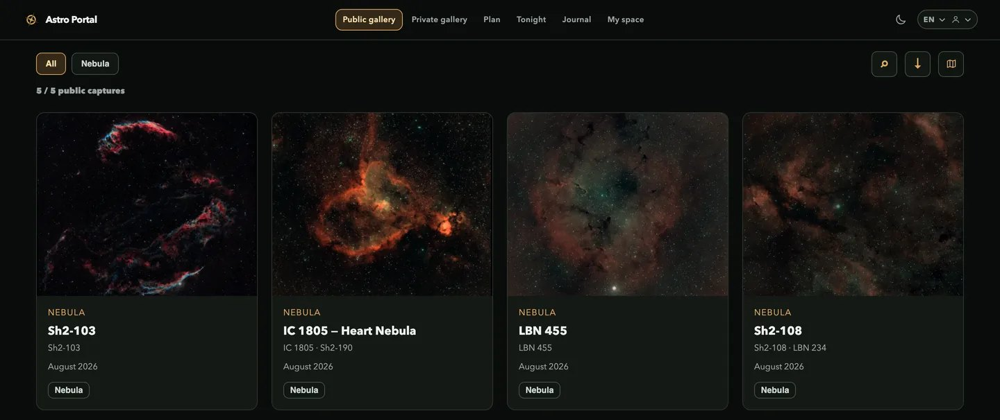

# Astro Portal

Astro Portal is a portal for astrophotographers that you run on your own
computer or server. It keeps your images and your nights in one place and
helps you plan the next one.



_The public gallery of a self-hosted portal, with captures taken with an
Askar 50P._

It brings together:

- **a gallery** of your images: originals are served without recompression,
  with their details, stacking progressions, plate-solving overlays and a
  personal sky map;
- **a night planner**: forecast, sky quality, recommendations for your
  equipment, constraints, the schedule of the night and an interactive sky map
  (Stellarium Web Engine); several plans at once;
- **your sessions**: the journal of each night, its captures, and the
  debriefing of a plan against what was actually shot;
- **a server for your devices**: the PlanAstro mobile application and
  [Astro Sync](https://github.com/sqound/astro-sync) (the desktop companion
  that sends your sessions) connect to it as a _private server_. A private
  server is one person's: its owner signs in with a password or a code
  received by e-mail, visitors only see what the owner publishes.

A hosted service is also available on
[planastro.space](https://www.planastro.space). A server of your own has no
limit on plans, storage, variants or history.

## Quick start with Docker

On Linux or macOS, with Docker and its Compose plugin installed:

```bash
git clone https://github.com/sqound/astro-portal.git
cd astro-portal
sh deploy/install.sh
```

The installer asks for a port (8787), a data folder (`$HOME/astro-portal-data`)
and the address to listen on, builds the image, starts the portal with
PostgreSQL, and prints the address and a one-time secret. Open the address,
create the owner's account, and you are done.

To build and run the image by hand, without Compose:

```bash
docker build -f apps/portal-oss/Dockerfile -t astro-portal .
docker run -d -p 8787:8787 -v astro-portal-data:/data \
  --env-file /path/to/astro-portal.env astro-portal
```

## Quick start without Docker

You need Node.js 24 (the version of `.nvmrc`) and about 2 GB of disk:

```bash
git clone https://github.com/sqound/astro-portal.git
cd astro-portal
npm ci
npm run build
npm start                     # http://localhost:8787
```

Without any setting, the portal runs without sign-in: only the public gallery
and the planner are available. Set up the sign-in before opening it to anyone.

## Configuration

Everything is set through environment variables; `.env.example` lists the
common ones and `deploy/self-hosting.env.example` is the template the Docker
installer fills in. The essentials:

| Variable                         | What it does                                                          |
| -------------------------------- | --------------------------------------------------------------------- |
| `PORT`, `HOST`                   | The port (8787) and the address the service listens on.               |
| `ASTRO_PORTAL_AUTH_MODE`         | `password` or `email-code`: how the owner signs in.                   |
| `ASTRO_PORTAL_SIGN_IN_KEY`       | The secret that protects sign-in data (generate a long random value). |
| `ASTRO_PORTAL_PUBLIC_URL`        | The public address of the service, used in the links of its messages. |
| `ASTRO_PORTAL_ADMIN_ALLOWED_IPS` | The addresses or networks allowed to use the administration.          |

The complete list, the data folders, a service that starts with the machine
(launchd, systemd or Docker), a reverse proxy or tunnel, backups and updates
are in **[docs/SELF_HOSTING.md](docs/SELF_HOSTING.md)** (in French:
[docs/fr/SELF_HOSTING.md](docs/fr/SELF_HOSTING.md)).

## Sample data

A demonstration night (plans, a session and its captures, under CC BY 4.0) is
prepared but not published yet. Once it is, `npm run sample:install` (or the
last step of `deploy/install.sh`) installs it into the owner's space, to see
every page filled; until then the command says so and changes nothing:
[docs/SAMPLE_DATA.md](docs/SAMPLE_DATA.md).

## Commands

| Command                   | What it does                                                                     |
| ------------------------- | -------------------------------------------------------------------------------- |
| `npm run build`           | Compiles the packages, then the application (`apps/portal-oss`).                 |
| `npm start`               | Starts the service (`apps/portal-oss/server.mjs`).                               |
| `npm test`                | Runs the tests of every package and of the application.                          |
| `npm run check`           | Build, tests and formatting: what a change must keep green.                      |
| `npm run backup:runtime`  | A backup of the database (and, on request, of the media files).                  |
| `npm run restore:runtime` | Restores a backup into an empty target, then verifies it.                        |
| `npm run sample:install`  | Installs the sample night into the owner's space, once it is published.          |
| `npm run deploy:release`  | Deploys the checked-out commit as an immutable release, with automatic rollback. |

## Layout

```text
apps/portal-oss/          the application: its Next.js routes, its server, its Dockerfile
packages/portal-app/      the routes, pages and server start of the application
packages/portal/          the core: persistence, sign-in, API services, components
packages/planner/         the night planner
packages/astro-core/      astronomy and catalogue data shared by every package
packages/astro-contracts/ the JSON contracts of the API, shared with the applications
packages/astro-theme/     the colour tokens
public/                   the Stellarium Web Engine and its sky data
examples/                 a small synthetic catalogue, the default gallery
scripts/                  backup, restore, sample data, releases
deploy/                   the Docker installer, launchd and systemd examples
docs/                     the documentation (English; French under docs/fr/)
```

## Reporting a problem

- A bug or a question: open an issue on
  [github.com/sqound/astro-portal/issues](https://github.com/sqound/astro-portal/issues)
  with the version (see `CHANGELOG.md`), what you did and what you saw. Leave
  out personal data: your images, your coordinates and your database stay with
  you.
- Anything else, or if you prefer e-mail: [dev@sqound.jp](mailto:dev@sqound.jp).
- A security vulnerability: do not open a public issue; follow
  [SECURITY.md](SECURITY.md).

## License

Astro Portal is free software under the **GNU Affero General Public License
v3.0 only** ([LICENSE](LICENSE)). If you run a modified version for others over
a network, you must offer them its source. A few packages
(`packages/astro-contracts`, `packages/astro-theme`) are under the MIT license,
stated in their `package.json`. Third-party assets keep their own licenses (the
Stellarium Web Engine and its data under `public/vendor/`, the fonts under their
OFL).

## Contributing

See [CONTRIBUTING.md](CONTRIBUTING.md). Astro Portal is published by Sqound.
