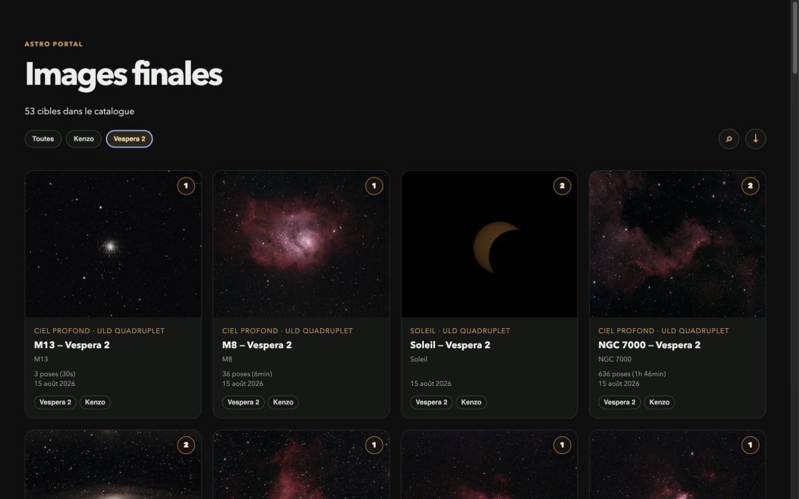
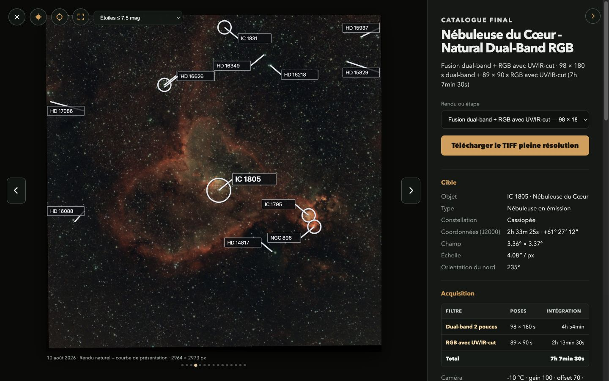
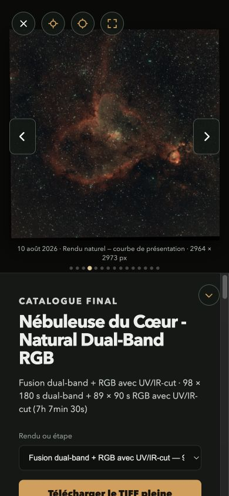
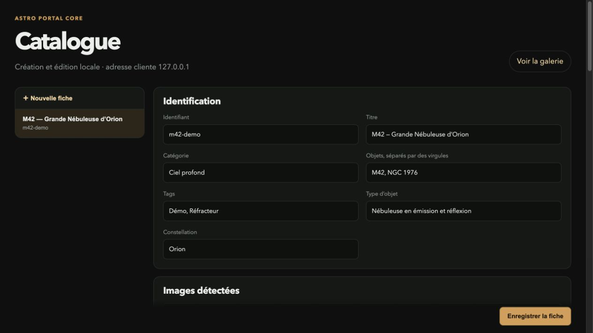
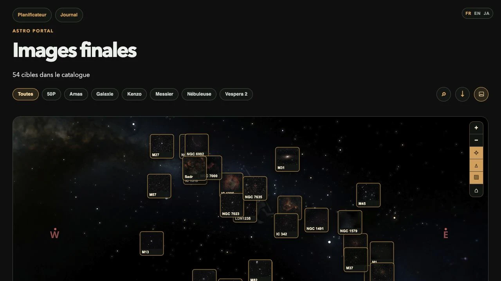
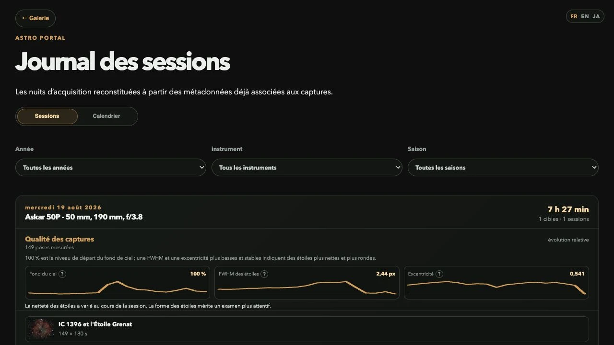
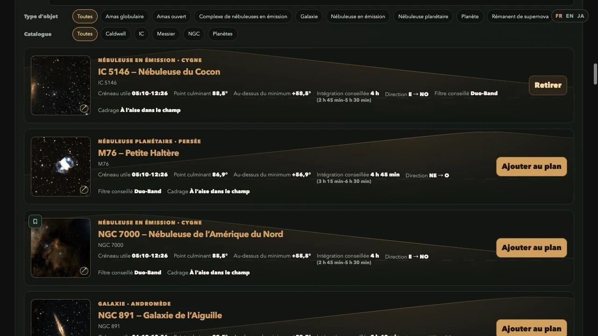
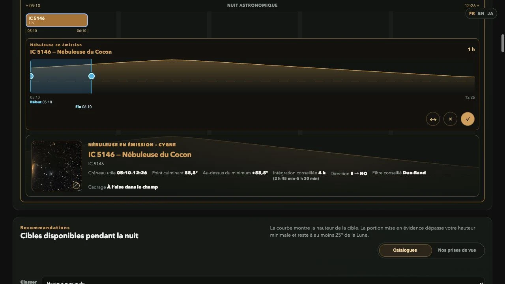

# Astro Portal Core

[Read the documentation in English](../../README.md)

Portail d’astrophotographie auto-hébergeable pour parcourir et partager ses
images finales sur un réseau local, avec une présentation proche d’un catalogue
astronomique. Les PNG/JPEG/WebP sont servis tels quels et les TIFF restent
réservés au LAN lorsqu’un tunnel Cloudflare est utilisé.

[](../../LICENSE)
[](../../package.json)

> Le projet est indépendant d’AstroBin, de Stellarium, de Vaonis et
> d’Astrometry.net. Ces noms désignent seulement des services ou outils avec
> lesquels le portail peut interagir.

## Aperçu

| Galerie et filtres                 | Fiche et plate solving                         |
| ---------------------------------- | ---------------------------------------------- |
|  |  |

| Responsive mobile                      | Éditeur local du catalogue       |
| -------------------------------------- | -------------------------------- |
|  |  |

### Carte du ciel personnelle



### Journal des sessions



### Planificateur d’observation

#### Recommandations de cibles



#### Éditeur de créneau



Les captures astronomiques proviennent d’un catalogue réel, mais les lieux ont
été masqués. Les captures du planificateur utilisent un lieu public de référence.
L’éditeur est illustré avec les données synthétiques du dépôt.

## Fonctionnalités

- galerie regroupée par cible, tags, recherche et tri chronologique ;
- pages de détail partageables qui conservent la cible et la version choisies ;
- variantes par rendu et courbe, navigation par flèches et points de position ;
- métadonnées d’acquisition, équipement, traitement, coordonnées et intégration
  détaillée par filtre ;
- progressions d’empilement avec lecture automatique et choix de la vitesse ;
- mode carte partageable de la galerie (`?view=map`) avec les miniatures des
  captures positionnées sur l’atlas céleste ;
- journal des sessions qui regroupe les acquisitions par nuit, avec filtres par
  année, instrument et saison astronomique, ainsi qu’une vue calendrier ;
- planificateur d’observation privé pour une date, un lieu et du matériel,
  proposant des cibles, leurs courbes de hauteur, des créneaux éditables, des
  plans sauvegardés et une synthèse météo astronomique à courte échéance ;
- connexion privée facultative du planificateur et de l’administration (un
  code reçu par e-mail, ou un mot de passe) : les invités conservent leurs
  plans dans le navigateur, le propriétaire connecté bénéficie d’une
  persistance privée par organisation ;
- plate solving local optionnel, annotations d’objets et étoiles filtrées par
  magnitude ;
- vue image seule adaptée au zoom mobile ;
- panneau d’informations rétractable en desktop et mobile ;
- éditeur `/admin` protégé par IP pour créer et modifier les fiches ;
- diffusion directe des originaux, sans recompression par le portail ;
- protection des TIFF lorsqu’une requête arrive par Cloudflare.

La liste détaillée se trouve dans [FEATURES.md](FEATURES.md).

## Démarrage rapide

Prérequis : Node.js 24.21.0 (la version de `.nvmrc`).

```bash
git clone https://github.com/sqound/astro-portal.git
cd astro-portal
npm install
npm run dev
```

Ouvrir ensuite [http://localhost:8787](http://localhost:8787). Le dépôt démarre
avec une cible M42 synthétique qui permet de tester la galerie, les variantes,
les progressions, la carte du ciel et l’éditeur.

Pour utiliser vos images :

```bash
ASTRO_PORTAL_IMAGES_DIR=/chemin/vers/images \
ASTRO_PORTAL_METADATA_DIR=/chemin/vers/catalogue \
npm run dev
```

Les images peuvent rester sur un disque externe. Le dépôt ne les copie, ne les
recode et ne les modifie pas.

## Production

```bash
npm run check
npm run build
HOST=0.0.0.0 PORT=8787 npm start
```

Les variables disponibles sont documentées dans
[INSTALLATION.md](INSTALLATION.md). Des exemples pour `launchd` et
`systemd` sont fournis dans [deploy/](../../deploy/).

## Ajouter ou modifier une cible

Depuis la machine qui héberge le portail, ouvrir
[http://localhost:8787/admin](http://localhost:8787/admin). L’éditeur détecte
les images, aide à constituer la fiche et écrit le JSON de façon atomique.

Pour autoriser une autre machine précise du LAN :

```bash
ASTRO_PORTAL_ADMIN_ALLOWED_IPS=192.168.1.42 npm start
```

Les réseaux CIDR sont aussi acceptés, par exemple `192.168.1.0/24`. Les requêtes
Cloudflare sont toujours refusées pour `/admin` et `/api/admin`, même si le
tunnel arrive localement. Voir [ADMINISTRATION.md](ADMINISTRATION.md).

## Documentation

- [Installation et configuration](INSTALLATION.md)
- [Fonctionnalités](FEATURES.md)
- [Modèle de données](DATA_MODEL.md)
- [Éditeur et contrôle d’accès](ADMINISTRATION.md)
- [Plate solving](PLATE_SOLVING.md)
- [Architecture](ARCHITECTURE.md)
- [Serveur privé : persistance et connexion (code par e-mail ou mot de passe)](PRIVATE_NOTEBOOK_AUTH.md)
- [Déploiement](DEPLOYMENT.md)
- [Confidentialité](PRIVACY.md)
- [Jeu d’exemple public (enregistrements et pack d’images, CC BY 4.0)](SAMPLE_DATA.md)
- [Intégration et liens Stellarium Web](STELLARIUM.md)
- [Journal des versions](CHANGELOG.md)
- [Contribuer](CONTRIBUTING.md)
- [Politique de sécurité](SECURITY.md)

## Licence

[GNU AGPL v3](../../LICENSE). Le portail inclut Stellarium Web Engine et ses
données célestes compactes non modifiées. La [notice d’intégration](../STELLARIUM.md)
indique la révision exacte et la procédure de reconstruction.
